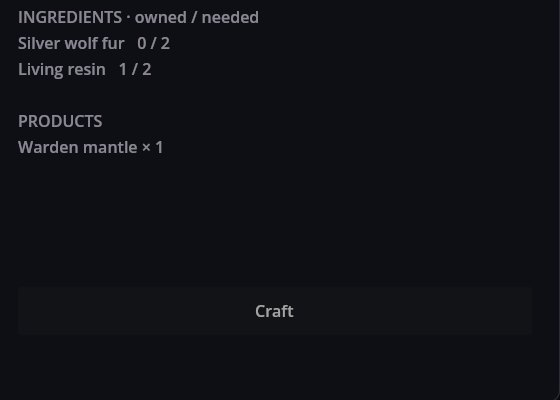
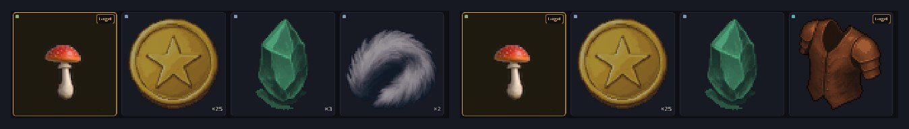

# Crafting — мастерские, превращающие материалы в предметы

Crafting добавляет станции, на которых игрок что-то мастерит: верстак, стол алхимика, швейный набор. Станция предлагает фиксированный список рецептов; каждый рецепт берёт из сумки одни предметы и выдаёт другие. Всё это данные — станция, рецепты и обычные предметы — а станцию открывает одна строка сценария. Работает в любой игре: из ответа в диалоге визуальной новеллы, щелчка по объекту или события на тайловой карте.

## В игре

В RPG Plus у деревенского колодца стоит верстак. Игрок собрал две серебристые шерсти и три живые смолы и выбирает плащ лесного стража:


- **Рецепты** слева; щёлкните по одному, чтобы рассмотреть.
- **Ингредиенты** показывают, сколько у вас есть и сколько нужно.
- **Изготовить** доступно, только когда всё на месте.

После **Изготовить**:



Сумка до и после — шерсть ушла, осталась одна смола, плащ прибыл:



Изготовление занимает время: игровые часы уходят вперёд на `Time` рецепта, в минутах — для плаща это 10. Сам плащ — экипировка (см. Equipment), носить его можно сразу.

## Станция и её рецепты

Верстак из RPG Plus:

```json
{
  "Kind": "craft_station",
  "Items": [
    {
      "Id": "rpg_plus/workbench",
      "Name": "rpg_plus/station/name",
      "Recipes": [ "rpg_plus/salve", "rpg_plus/mantle", "rpg_plus/lantern" ]
    }
  ]
}
```

и один из его рецептов:

```json
{
  "Kind": "recipe",
  "Items": [
    {
      "Id": "rpg_plus/mantle",
      "Name": "rpg_plus/recipe/mantle/name",
      "Description": "rpg_plus/recipe/mantle/desc",
      "Time": 10,
      "Input": [ { "Id": "rpg_plus/wolf_pelt", "Count": 2 }, { "Id": "rpg_plus/resin", "Count": 2 } ],
      "Output": [ { "Id": "rpg_plus/fur_mantle", "Count": 1 } ]
    }
  ]
}
```

- Станция перечисляет рецепты по id, в порядке показа; рецептами можно делиться между станциями.
- `Input` берётся из сумки, `Output` в неё добавляется; `Time` — в игровых минутах.
- Имена и описания — ключи переводов вашего мода.

Учить эти рецепты заранее не нужно: станция предлагает все свои.

## Открытие станции

Событие верстака на карте деревни запускает сценарий:

```scenario
ptext "На верстаке лежит инструкция: «Не пробовать. Не нюхать.»" key=rpg_plus/woodland/workbench/1
action craft.open station=rpg_plus/workbench
end
```

Пока окно открыто, игрок не может ходить; Esc его закрывает.

## Сначала проверка, потом изменения

Изготовление проверяется целиком до того, как что-то меняется: каждый ингредиент и продукт должны существовать, количества должны быть положительными, а в сумке всего должно хватать. Если что-то не так — не берётся ничего. Созданные предметы — обычные предметы, поэтому они сохраняются вместе с сумкой.

## Если что-то пошло не так

1. **«Изготовить» серое.** Не хватает ингредиента; числа «есть / нужно» показывают, какого.
2. **Рецепта нет в окне.** Станция называет в `Recipes` id, на который не откликается ни один рецепт.
3. **Окно не открывается.** id в `station=` не совпадает ни с одной станцией; проверьте лог.
