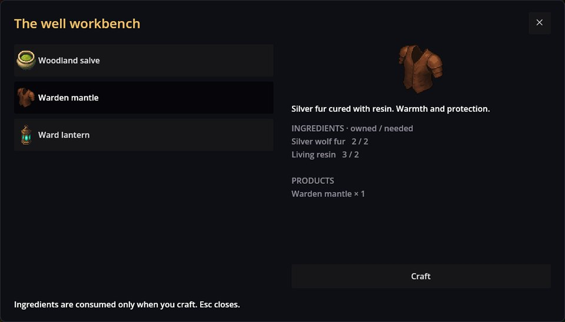

# Crafting——把材料变成物品的工作台

Crafting 添加了让玩家动手制作的站点：工作台、炼金台、针线包。一个站点提供固定的配方列表；每份配方从背包取走一些物品，再交给你另一些。一切都是数据——站点、配方和普通物品——而剧本只要一行命令就能打开站点。它在任何游戏中都能用：可以是视觉小说里的一个对话选项、一次对物体的点击，或者图块地图上的一个事件。

## 在游戏中

RPG Plus 在村中水井旁有一个工作台。玩家已经收集了两张银狼皮和三份活树脂，选中的是守林人披风：



- 左侧是**配方**；点击即可查看。
- **原料**显示你有多少、需要多少。
- 只有东西齐了，**Craft** 才可用。

按下 **Craft** 之后：


制作前后的背包——狼皮没了，剩一份树脂，披风到手：


制作需要时间：游戏时钟按配方的 `Time` 前进若干分钟——披风是 10 分钟。披风本身是装备（见 Equipment），做完马上就能穿。

## 站点与配方

RPG Plus 的工作台：

```json
{
  "Kind": "craft_station",
  "Items": [
    {
      "Id": "rpg_plus/workbench",
      "Name": "rpg_plus/station/name",
      "Recipes": [ "rpg_plus/salve", "rpg_plus/mantle", "rpg_plus/lantern" ]
    }
  ]
}
```

以及其中一个配方：

```json
{
  "Kind": "recipe",
  "Items": [
    {
      "Id": "rpg_plus/mantle",
      "Name": "rpg_plus/recipe/mantle/name",
      "Description": "rpg_plus/recipe/mantle/desc",
      "Time": 10,
      "Input": [ { "Id": "rpg_plus/wolf_pelt", "Count": 2 }, { "Id": "rpg_plus/resin", "Count": 2 } ],
      "Output": [ { "Id": "rpg_plus/fur_mantle", "Count": 1 } ]
    }
  ]
}
```

- 站点按 id、按显示顺序列出配方；不同站点可以共用配方。
- `Input` 从背包扣除，`Output` 加入背包；`Time` 以游戏分钟计。
- 名称和描述是你 mod 的翻译键。

玩家不需要先学习这些配方：站点会给出它自己的全部配方。

## 打开站点

村庄地图上工作台的事件运行：

```scenario
ptext "工作台上放着一份说明：“不要品尝。不要嗅闻。”" key=rpg_plus/woodland/workbench/1
action craft.open station=rpg_plus/workbench
end
```

窗口打开时玩家不能走动；Esc 关闭窗口。

## 设计上就安全

一次制作在改动任何东西之前会被完整检查：每种原料和成品都必须存在，数量必须为正，背包里的存货必须够用。任何一处不对，就什么都不拿。制作出的物品是普通物品，因此随背包一起存档。

## 出问题了？

1. **Craft 一直是灰色。** 缺少原料；“已有 / 需要”的数字会告诉你缺哪个。
2. **窗口里少了一个配方。** 站点的 `Recipes` 里写了一个没有任何配方使用的 id。
3. **窗口打不开。** `station=` 的 id 和任何站点的 id 都对不上；去看日志。
